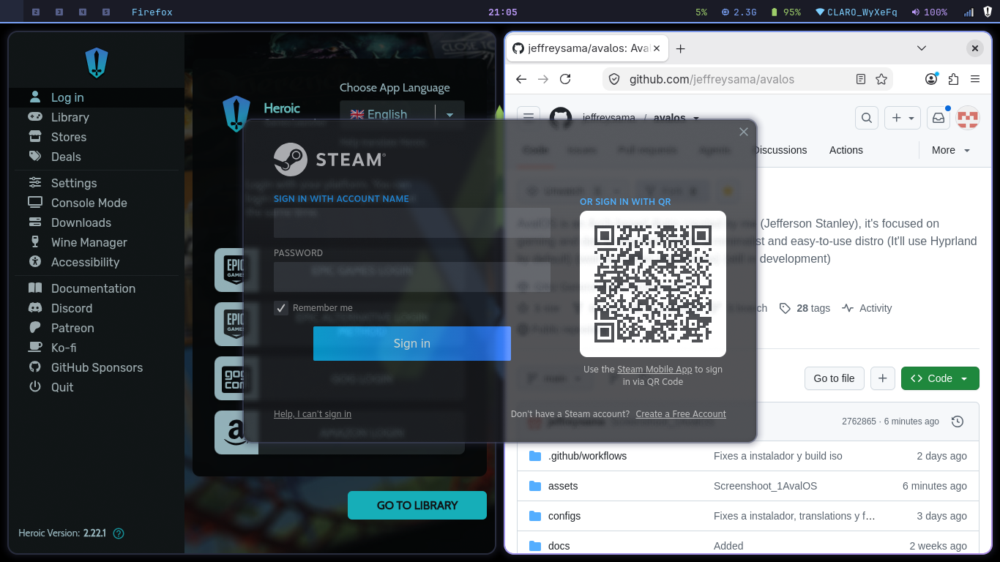
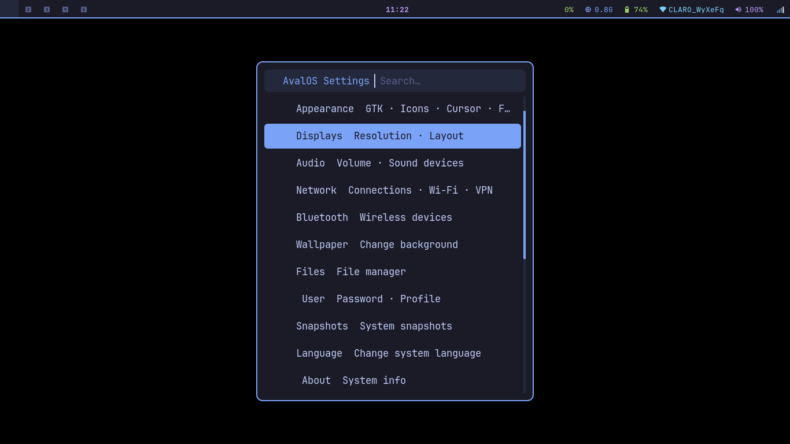
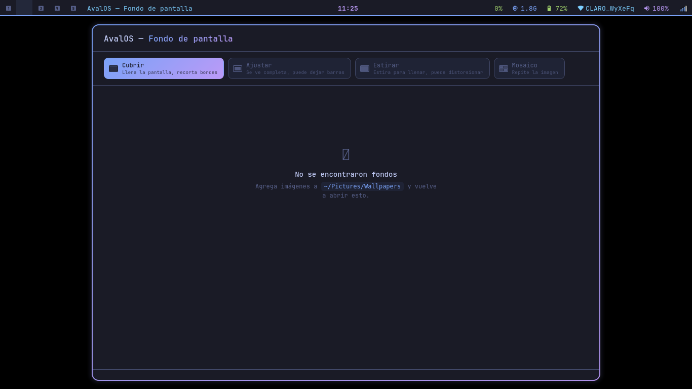

# AvalOS


**AvalOS** is a minimalist, beautiful, and high-performance Arch-based Linux distribution focused on **gaming** and **daily productivity**.

It ships with **Hyprland** (Wayland) as the default desktop environment, delivering a modern, lightweight, and highly customizable experience right out of the box.

---

## ✨ Features

- **Base**: Arch Linux (rolling release)
- **Desktop Environment**: Hyprland (Wayland)
- **Philosophy**: Minimalism, performance, and ease of use
- **Target Users**: Gamers, developers, and power users who want something clean and fast
- **Custom Kernel**: `linux-avalos` (optimized for desktop/gaming) + `linux-avalos-bore` and `linux-avalos-compat` variants
 - `linux-avalos-bore` uses the **BORE** scheduler (Burst-Oriented Response Enhancer) by [firelzrd](https://github.com/firelzrd/bore-scheduler), with adaptations from [CachyOS](https://github.com/CachyOS/kernel-patches)
- **Filesystem**: Btrfs with Snapper snapshots by default
- **Pre-configured Rice**: Beautiful and functional Hyprland + Waybar + Kitty + Rofi setup included
- **Extras**: ZRAM, BBR congestion control, carefully selected firmware (AMD/Intel only)
- **Built-in tools**: AvalOS Welcome, Settings, Store, Update, Restore and Doctor (see [AvalOS Tools](#-avalos-tools))
- **Languages**: the installer and the tools are available in English, Español, 中文简体 and 日本語

> **Note**: AvalOS currently supports **AMD and Intel** hardware only. NVIDIA is not supported, but could be possible (If you know how to install NVIDIA packages and all).

---

## 📸 Screenshots






---

## 📥 Installation

AvalOS ISOs are fully functional and ready for use.


### Quick steps

1. Download the latest ISO from the [Releases](https://github.com/jeffreysama/avalos/releases) page.
2. Flash it to a USB drive (Ventoy, Rufus, `dd`, or the included USB maker scripts).
3. Boot from the USB.
4. Follow all the steps from auto installer and wait the system to be downloaded on your disk, OR do a manual installation

**→ [Manual Installation Guide](docs/INSTALL.md)**

The manual guide produces an installation that is functionally identical to what the automatic installer would create (Btrfs + Snapper layout, same package set, same configs, same kernel line, etc.).

---

## ⚠️ Current Status

AvalOS is under active development.

- ISOs are fully usable and AvalOS is now installable via auto install
- Automatic installer is working correctly now!
- Only AMD and Intel GPUs are supported at this time

---

## 🛠️ System Highlights

- Custom optimized kernel line (`linux-avalos`)
- Btrfs with a clean 6-subvolume layout + Snapper + grub-btrfs
- ZRAM by default
- BBR + modern sysctl tuning
- Full Hyprland rice pre-configured (Hyprland, Waybar, Kitty, Rofi, Mako, SDDM theme, etc.)
- Ready for gaming (Steam, Wine, Proton-GE, Lutris, MangoHud, GameMode…)

---

## 🧰 AvalOS Tools

AvalOS ships its own small apps, all available from the app launcher:

| Tool | What it does |
|------|--------------|
| **AvalOS Welcome** | First steps and key shortcuts, shown on your first login |
| **AvalOS Settings** | Control center for your installed system |
| **AvalOS Store** | Install games, apps and utilities from a curated catalog (Pacman, AUR and Flatpak) |
| **AvalOS Update** | Update system packages, the kernel, AUR, Flatpak and AvalOS itself, and can take a Btrfs snapshot first as a safety net |
| **AvalOS Restore** | Roll the system back to an earlier snapshot without a USB drive; the current state is snapshotted first, so the restore can be undone |
| **AvalOS Doctor** | Health check across System, Storage, Packages, Hardware, Network and AvalOS: what needs attention comes first, and the report can be copied |

---

## 🧪 Tests

Run the whole suite from the repository root:

```bash
python3 -m unittest discover -s tests -v
```

The **Validar configs** workflow runs it on every push that touches `configs/`, `scripts/`, `tests/` or the workflows, next to validators that use the real parsers (GTK CSS, Lua, desktop files). A few tests use real tools (`parted`, `sfdisk`, `mke2fs`, `flatpak`, `pacman`) on disk images and throwaway repositories; they are skipped when a tool is not installed.

---

## 🤝 Contributing

Issues, pull requests, and feedback are fully welcome!.

---

## License

**This project is licensed under the [GPL-3.0 License](LICENSE).**
